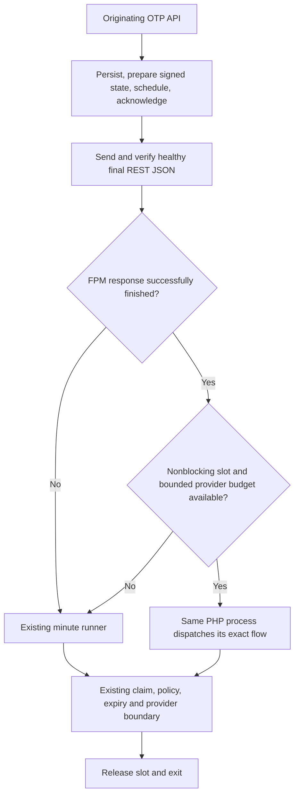

# Pinova Immediate OTP Delivery After Response - Plan

## Goal Capsule

- **Objective:** Customers receive requested sign-in codes promptly without losing a minute to local scheduling.
- **Means:** Proposed delivery in the existing PHP request only after its successful REST response is fully flushed (KTD1–KTD4).
- **Authority:** User execution approval, this Product Contract, and repository safety contracts govern execution; artifact readiness is not approval.
- **Execution profile:** Characterize real PHP-FPM behavior on isolated compute, publish a reviewed candidate, then use the approved staging and production targets.
- **Stop conditions:** Stop if response ordering, bounded provider execution, or FPM capacity cannot be proved; a different privacy or delivery model requires a revised proposal.
- **Tail ownership:** The implementing task owns reviewed source delivery, candidate verification, staged acceptance, approved production activation, rollback, and the complete 24-hour observation report.

---
## Product Contract

### Summary

Keep the durable encrypted OTP queue, then attempt exact-flow delivery in the already-loaded PHP process after its healthy REST response finishes. The opt-in flag starts off and the minute runner remains fallback.
This proposal awaits approval and replaces five-second polling.

### Problem Frame

One observed flow waited 54 seconds for the runner and six more through its provider result, consuming 60 seconds of the existing 180-second window.
The imported 1.2.2 baseline sent before returning signed state; the later queue separates public responses from account/provider timing. Pre-response sending would change that boundary.

### Requirements

**Delivery and privacy**

- R1. Under normal load with fast-path capacity available, provider execution starts within one second after response flush; request-to-provider acceptance has a separate target of at most 15 seconds, without guaranteeing phone receipt.
- R2. The new same-process fast path begins delivery-time account resolution and provider execution only after the final healthy Pinova REST JSON is fully committed and FPM successfully finishes the response; failed, replaced, fatal, or unsupported response paths retain ordinary queued delivery. This is a server-side completion boundary, not a guarantee of remote browser receipt.
- R3. Preserve generic public responses, original 180-second signed deadlines, purpose separation, durable acknowledgement, encryption, claims, rate limits, cancellation/erasure barriers, and uncertain-provider no-resend behavior.

**Resources and rollout**

- R4. Bound site-wide concurrent fast flows and cumulative provider execution; capacity denial or resource pressure defers unclaimed work to the existing runner without blocking the public response.
- R5. Ship a new reviewed immutable RC, keep the feature default-off, and activate only the explicitly approved targets after staged safety, resource, delivery, and rollback acceptance.

### Success Criteria and Scope

R1–R5 pass isolated and staging acceptance before production activation, then remain satisfied throughout the 24-hour canary.
Scope covers the originating APIs, exact-flow dispatch, capacity/deadline controls, tests, documentation, and release delivery. No new public endpoint, poller, cron entry, PHP tuning, or general/email-cron change is included. Polling and external wake-up remain deferred alternatives.

### Acceptance Examples

- AE1. Covers R1/R2: an independent HTTP client receives complete generic JSON without waiting for a deliberately slow provider; server-side markers prove that the new same-process delivery work starts after successful response completion and handles only that acknowledged flow.
- AE2. Covers R3/R4: concurrent cron and fast-path workers send at most once, while a full fast-path capacity budget leaves the next flow safely queued.
- AE3. Covers R2/R5: another filter replaces the response, PHP fails before flush, or FPM completion is unavailable; no fast-path provider call occurs and the existing runner remains effective.

---
## Planning Contract

### Evidence and Assumptions

Earlier idle CLI runs averaged 5.09 CPU-seconds and 324–325 MiB RSS; bootstrap-free probes averaged 0.082 CPU-seconds and 45 MiB RSS. Neither establishes this fast path's incremental CPU, retained RSS, occupied-FPM time, or capacity.
Measure those costs on the representative plugin profile; observed shared-pool saturation makes capacity release-blocking.

**Sources:** Imported synchronous baseline: commit `771b3d57f58e78db2a279525ac2bcd6a8ddecc84`, `src/API/UserAPI.php`, and `src/Services/OTPService.php`. Current contracts: `src/Services/OTPQueueStore.php` and `.agents/skills/pinova-development/references/project-map.md`.

### Key Technical Decisions

- KTD1. **Flush before dispatch.** Use the actual REST/FPM completion lifecycle and require `fastcgi_finish_request()` to return true after a verified healthy final response; preparing a response or mocking the function is insufficient (R2).
- KTD2. **Arm server-owned exact flows.** Only successful `UserAPI` and `MobileVerificationAPI` issuance may arm their own acknowledged, scheduled flow; never accept a client-supplied wake-up identifier or dispatch a global batch (R2/R3).
- KTD3. **Reuse existing delivery ownership.** Invoke `OTPService::deliver_queued()` once for that flow through existing queue claims, policy, deadline, and cancellation controls; cron may race safely and remains the fallback (R3).
- KTD4. **Limit concurrent FPM tails.** Propose two nonblocking, site-wide connection-owned fast-path slots behind a default-off configuration flag; per-flow locking alone does not bound FPM usage (R4).
- KTD5. **Bound all provider work.** Establish a short aggregate deadline accounting for sequential configured channels and supported provider timeouts before claiming. Unbounded/unknown provider capability defers to cron; never forcibly retry an ambiguous send (R3/R4).
- KTD6. **Keep operational scope narrow.** No global PHP or scheduler tuning is included. `request_terminate_timeout_track_finished` and post-finish timeout behavior require explicit verification; server timeout assumptions do not establish a bounded tail (R4/R5).
- KTD7. **Publish a new runtime candidate.** Select the next unused RC only after reviewed source and exact-head/merged-main CI pass; preserve the installed candidate and every immutable tag unchanged (R5).

### High-Level Technical Design

The existing schedule is due immediately and acknowledged after the signed response is prepared; an independent cron worker may already claim it before the originating response finishes. R2 governs only the new same-process path and does not introduce a global response-flush barrier or alter that existing queue protocol.

The PHP-FPM child remains occupied after server-side response completion. Proxy buffering and network delay can postpone browser receipt; the fast path must not make the public response wait for delivery work. It never calls the CLI wrapper or inherits its initial 20-second sleep.
Slow/unknown providers, capacity denial, and busy claims fall outside the fast target and retain bounded deferral evidence.

---
## Implementation Units

### U1. Characterize the actual REST and PHP-FPM completion boundary

**Goal:** Prove the required ordering before adding delivery behavior. **Requirements:** R1/R2/R4. **Dependencies:** None.
**Files:** `tests/Integration/otp-fpm-response-boundary.php`, `tests/Integration/otp-fpm-response-boundary.sh`, `tests/fixtures/fpm-otp/` (new), `.github/workflows/quality.yml`.
**Approach:** Build an isolated real FPM/HTTP fixture with a nonbillable stub provider, independent observer, and representative response filters; characterize normal and finished-request termination behavior.
**Test scenarios:**
1. Covers AE1: independent server markers place same-process delivery-time account lookup and provider entry after successful FPM completion; a real HTTP client confirms that healthy complete JSON does not wait for a deliberately slow provider. Browser packet arrival need not precede provider entry, and independent cron may retain its existing race.
2. Covers AE3: failed/replaced response, fatal shutdown, partial output, unsupported SAPI, and false completion prevent fast dispatch without disrupting scheduled fallback.
3. An intentionally slow provider demonstrates occupied FPM time and actual timeout controls; Apache wp-env and mocked completion alone cannot satisfy this gate.
**Verification:** Real FPM receipts prove R2 and expose an enforceable short aggregate provider budget; otherwise stop and replan.

### U2. Add opt-in exact-flow dispatch and finite fast-path capacity

**Goal:** Accelerate eligible delivery after successful response completion. **Requirements:** R1–R4; AE1–AE3. **Dependencies:** U1.
**Files:** `src/API/UserAPI.php`, `src/API/MobileVerificationAPI.php`, `src/Services/OTPService.php`, `src/Services/OTPQueueStore.php` if slots require it, affected first-party provider adapters, and `tests/Integration/OTPWorkerIntegrationTest.php`.
**Approach:** Implement KTD1–KTD6 at the existing acknowledged-queue seam; keep reservation formats, cron scheduling, token shape, and provider result classification unchanged.
**Test scenarios:**
1. The flag off, unsupported provider budget, pressure, occupied slot, or unavailable claim leaves existing queued behavior intact and introduces no public result differences.
2. Both originating APIs arm only their acknowledged server-owned flow; an unrelated pending flow is never dispatched by this request.
3. Concurrent fast-path and cron workers preserve one provider attempt, release connection-owned slots on exit/crash, and enforce the cumulative deadline across channels.
**Verification:** The real FPM fixture and queue regressions pass with the flag on/off; capacity and deadline failures defer before sending.

### U3. Prove safety, latency, and FPM resource limits

**Goal:** Establish measurable benefit and capacity before release activation. **Requirements:** R1–R4. **Dependencies:** U2.
**Files:** `tests/Integration/OTPQueueRecoveryIntegrationTest.php`, `tests/Integration/OTPQueueConcurrencyIntegrationTest.php`, `tests/Integration/OTPPurposeIntegrationTest.php`, affected privacy/public-response tests, and the U1 fixture.
**Approach:** Use isolated real HTTP/FPM and independent database workers with stubbed outbound providers; measure equal baseline/candidate idle, single-flow, concurrent, and slow-provider windows.
**Test scenarios:**
1. Acknowledgement, expiry, erasure/cancellation, purpose mismatch, reused OTP, provider false/exception/unknown acceptance, and crash recovery retain existing outcomes without duplicate sends.
2. More concurrent requests than the proposed slot cap defer excess work; mixed ordinary page traffic remains responsive and FPM queueing/worker occupancy stays within predeclared baseline-relative headroom.
3. At least ten nonbillable flows demonstrate R1 under normal uncontended conditions; report CPU, incremental/retained RSS, worker-seconds, FPM saturation/queueing, DB/Redis deltas, and provider timing separately.
**Verification:** Record numeric headroom and regression limits from the actual representative baseline before candidate tests; reject increased FPM saturation, unbounded tails, secret exposure, or failed R1 rather than tuning production to pass.

### U4. Deliver a reviewed candidate, stage, activate, and observe

**Goal:** Demonstrate real delivery improvement with a tested rollback. **Requirements:** R1–R5. **Dependencies:** U3 and explicit scenario approval.
**Files:** `README.md`, `CHANGELOG.md`, `readme.txt`, plugin version metadata and matching upgrade method, `.agents/skills/pinova-development/SKILL.md`, routed project-map/quality/logging contracts, and `.agents/reviews/2026-10-25-otp-latency-acceptance.md` (new).
**Approach:** Land the focused change with required review/CI, publish and independently verify the next unused immutable RC, then install its published ZIP on staging before approved production activation.
**Test scenarios:**
1. On the representative staging profile, verify default-off compatibility, enable the opt-in fast path, prove ordering/capacity/rollback, and send one approved SMS to the privately authorized recipient.
2. After staging passes, obtain verified fresh production recovery backups and preserve administrator access; deploy/enable only the approved target and send one approved SMS without automatic resending.
3. Observe the full 24 hours for expired/duplicate flows, worker failures, latency, resource/ordinary-page regressions, PHP/web errors, and general/email cron progress; incomplete or failed acceptance prevents completion.
**Verification:** Rollback disables new fast dispatch, drains in-flight native work without killing a provider request, restores the prior verified plugin/configuration, and leaves queued flows for the unchanged runner.

---
## Verification Contract

- Run the new real FPM/HTTP fixture and existing queue, recovery, concurrency, purpose, privacy, and public-response suites on isolated compute; retain the applicable PHP/WordPress/WooCommerce CI matrix.
- Require PHP lint, PHPUnit, PHPStan, WPCS, audits, workflow/ShellCheck gates, `php tools/check-ai-governance.php`, `php tools/check-changelog-sync.php`, and `bash .agents/skills/pinova-development/scripts/check-skill-sync.sh --working-tree`.
- Require exact-head and merged-main CI, reproducible ZIP/SBOM, native Release immutability, attestations, fresh downloads, and published-package staging acceptance before production.
- Never run development fixtures or load tests on production; production proof is limited to explicitly approved acceptance and passive observation.

---
## Definition of Done

- U1–U4 pass their verification, R1–R5 have bounded evidence, and the reviewed default-off feature ships in a verified new RC.
- The approved production activation completes the full observation window; provider acceptance and human receipt are recorded separately without requesting the OTP.
- Rollback and the existing cron fallback remain available; temporary fixtures, abandoned attempts, and unintended configuration changes are removed.
- The final report names exact source/release evidence, changed files, measured latency/FPM costs, external effects, rollback state, and residual limits without exposing private targets or recipients.
